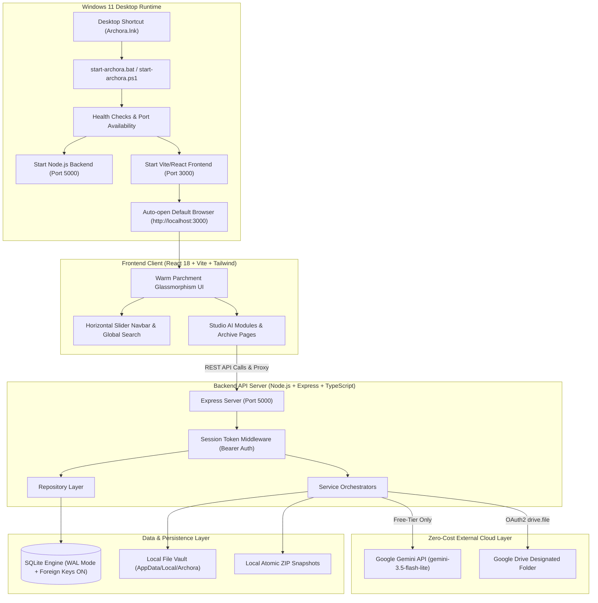
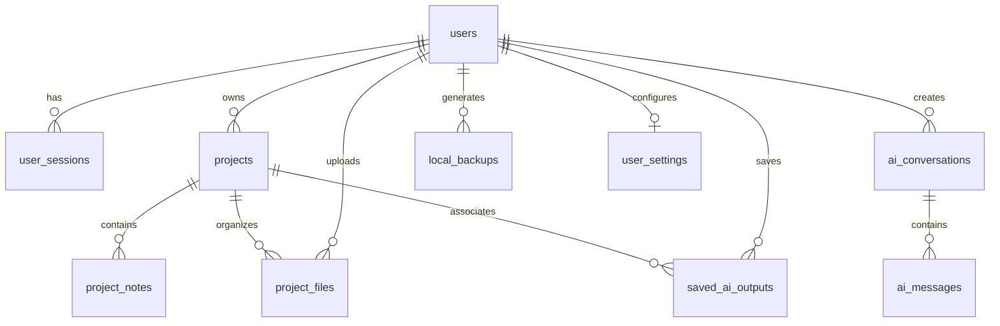

# Archora — Master Architecture, Features & Technology Guide

> **Archora** is a specialized, intelligent architectural design workspace engineered for architecture students and designers. It synthesizes deep historical precedent knowledge, generative climatic design concepts, structured jury defense preparation, persistent local SQLite archiving, and Google Drive cloud offloading—all operating under a **Strict Zero-Cost Policy**.

---

## 1. High-Level System Architecture & Flow

Archora is engineered as an **offline-first, desktop-launched local web platform** running simultaneously on Windows through an automated dual-process architecture:

---

## 2. Technologies & Tools Matrix

| Area / Subsystem | Technology / Library | Purpose & Implementation Details |
| :--- | :--- | :--- |
| **Frontend Framework** | **React 18 + TypeScript** | Component-driven reactive UI, type-safe state management, hook-based modularity. |
| **Frontend Build Tool** | **Vite 5** | Instant hot-module replacement (HMR), optimized Rollup production bundling (`dist/`). |
| **Styling & Design System** | **Tailwind CSS 3** | Warm parchment & espresso editorial color scheme (`#F3E5CF`, `#FFF7EA`, `#482A18`), custom backdrop blur and glass shadow tokens. |
| **Icons & Typography** | **Lucide React + Cormorant Garamond** | Crisp SVG architectural iconography paired with an academic serif font for headlines. |
| **Backend Framework** | **Node.js (v25) + Express 4** | RESTful HTTP API services, routing, rate limiting, and multipart stream uploads. |
| **Runtime & Execution** | **`tsx` (TypeScript Execute)** | Native zero-compile execution of TypeScript backend modules in modern ES module format. |
| **Database Engine** | **SQLite 3 via `better-sqlite3`** | High-performance, embedded relational database with zero external server dependencies, Write-Ahead Logging (WAL), and PRAGMA integrity verification. |
| **Database Migrations** | **Custom Versioned SQL Migrations** | Sequential schema migrations (`001` through `009`) ensuring smooth updates and safe rollback. |
| **AI Intelligence** | **Google Gemini (`gemini-3.5-flash-lite`)** | Academic architectural synthesis, spatial reasoning, precedent analysis, and jury viva prediction. Free-tier model strictly enforced. |
| **Cloud Storage** | **Google Drive API (v3) + `googleapis`** | Primary cloud storage for large drawings, floor plans, and versions via designated folder (`1hTYk7StoL5GsRpitJyAwdaVf_ivleUWl`). |
| **File Uploads & Handling** | **`multer`** | Multi-format architectural file processing supporting `.dwg`, `.dxf`, `.pdf`, `.png`, `.jpg`, `.webp`, `.docx`. |
| **PDF Dossier Engine** | **`pdfkit`** | Native vector architectural PDF document generator formatting A4 dossiers with margins, headers, and metadata. |
| **Backup & Snapshot Archive** | **`archiver` + `adm-zip`** | Atomic compression of SQLite database and drawing assets into timestamped ZIP files with SHA-256 manifests and Zip-Slip traversal protection. |
| **Authentication & Security** | **`bcrypt` + UUID tokens** | Secure local password hashing, bearer session tokens, and strict cross-user data isolation. |
| **Windows Deployment** | **Windows Batch (`.bat`) + PowerShell 7** | Double-click desktop startup, graceful shutdown, duplicate prevention, and clean port recycling. |

---

## 3. Comprehensive Feature Breakdown

### 1. Master Navbar & Glassmorphism System
- **The Tech:** Tailwind CSS custom utilities, Lucide icons, React `useRef` & `scrollBy`.
- **How it works:**
  - Pins the Archora logo on the left with a hairline architectural divider to eliminate crowding.
  - Houses navigation links inside a smooth horizontal slider with lateral chevron controls and edge gradient masks.
  - Automatically scrolls the active route into the center of the viewport upon navigation.
  - Right-aligned studio cluster with Search (`/` key shortcut), student profile badge, and logout.

### 2. Architecture Tutor (`/tutor`)
- **The Tech:** [`aiService.ts`](file:///d:/Archora/server/services/aiService.ts), [`aiHistoryRepository.ts`](file:///d:/Archora/server/repositories/aiHistoryRepository.ts), Google Gemini API.
- **How it works:**
  - Architecture-specific system prompt trained in architectural history, tectonic construction, typological precedents, and vernacular methods.
  - Suggests contextual prompt chips (e.g., *Biophilic ventilation in hot-humid climates*, *Brutalist concrete tectonics*).
  - Every message and response is streamed, formatted with markdown, and automatically persisted into SQLite database conversation tables.

### 3. Design Concept Generator (`/concepts`)
- **The Tech:** [`aiService.ts`](file:///d:/Archora/server/services/aiService.ts), [`DesignConceptGenerator.tsx`](file:///d:/Archora/src/pages/DesignConceptGenerator.tsx).
- **How it works:**
  - Accepts a structured design brief: Project Title, Typology, Site Location, Architectural Style, Constraints, and Cultural Context.
  - Synthesizes 4 distinct architectural pillars:
    1. **Core Concept Statement:** Philosophical foundation.
    2. **Spatial & Form Rationale:** Circulation, massing, zoning, and orientation.
    3. **Climatic & Passive Strategy:** Solar path, thermal mass, prevailing winds, rainwater harvesting.
    4. **Tectonic Materiality:** Structure, joinery, facade articulation, and local materials.
  - Outputs can be linked to projects, copied, printed, exported to PDF, or saved to the studio archive.

### 4. Jury & Portfolio Assistant (`/portfolio`)
- **The Tech:** Structured JSON schema extraction, Gemini API, [`JuryPortfolioAssistant.tsx`](file:///d:/Archora/src/pages/JuryPortfolioAssistant.tsx).
- **How it works:**
  - Prepares students for demanding studio jury defenses:
    - **Jury & Viva Questions:** Generates the top 5 anticipated questions, examiner's underlying intent, key points to address, and recommended defense arguments.
    - **10-Min Presentation Arc:** Chronological script balancing problem statement, site analysis, tectonic solution, and impact.
    - **Concept Statements & Abstracts:** Polished editorial text for presentation boards and competition entries.

### 5. Project Library & Archive (`/projects`)
- **The Tech:** [`projectRepository.ts`](file:///d:/Archora/server/repositories/projectRepository.ts), SQLite database migrations `001` and `002`.
- **How it works:**
  - Tracks complete architectural project metadata across 15 fields: Title, Typology, Category, Semester, Subject, Academic Year, Site Location, Site Dimensions, Footprint Area, Architectural Style, Status (In Progress, Review Ready, Completed), Start Date, Completion Date, Design Requirements, and Narrative Description.
  - Integrated Project Detail View with 5 sub-tabs: Overview, Site Parameters, Linked AI Outputs, Studio Notes, and Drawings/Files.
  - Supports grid and list views, dynamic multi-filter searching, and sorting.

### 6. Architectural File Vault (`/files`)
- **The Tech:** `multer`, [`fileRepository.ts`](file:///d:/Archora/server/repositories/fileRepository.ts), [`fileRoutes.ts`](file:///d:/Archora/server/routes/fileRoutes.ts).
- **How it works:**
  - Manages floor plans, sections, elevations, site analyses, 3D renderings, and vector CAD files (`.dwg`, `.dxf`, `.pdf`, `.png`, `.jpg`, `.docx`).
  - Interactive drawing inspector with zoom controls and project-association selectors.
  - Files are stored with sanitized names and indexed in SQLite with metadata, MIME types, and byte sizes.

### 7. Google Drive Primary Cloud Storage & Low-Disk Offloader
- **The Tech:** [`googleDriveStorageService.ts`](file:///d:/Archora/server/services/googleDriveStorageService.ts), Google Drive API (v3).
- **How it works:**
  - Designated destination folder ID: `1hTYk7StoL5GsRpitJyAwdaVf_ivleUWl`.
  - **Low Local Storage Guardrail:** Designed for laptops with low disk space (< 10 GB).
  - When an architectural drawing is uploaded, it uploads directly to Google Drive. Once confirmed, the heavy local physical copy is automatically unlinked, while the file's metadata and Drive preview IDs are safely retained in SQLite. This saves disk space while keeping files fully browsable and downloadable.
  - **Website Data Sync:** Compiles safe versioned JSON snapshots of projects, notes, and AI outputs to Google Drive (with an automated audit ensuring 0 passwords or API keys are ever uploaded).

### 8. Local Backup & Disaster Restore System
- **The Tech:** [`backupService.ts`](file:///d:/Archora/server/services/backupService.ts), `archiver`, `better-sqlite3`.
- **How it works:**
  - Creates 100% genuine atomic ZIP backup archives of the SQLite database and drawing assets.
  - Generates a `manifest.json` containing SHA-256 file hashes, timestamp, schema version, and project count.
  - **Pre-Restore Safety Snapshot:** Before executing any restore operation, Archora takes an automatic safety snapshot of the current database. If the restore encounters corruption, it performs an immediate atomic rollback.
  - **Zip-Slip Traversal Prevention:** Rejects any ZIP containing directory traversal paths (`../`).

### 9. Architectural PDF Dossier Generator
- **The Tech:** [`pdfService.ts`](file:///d:/Archora/server/services/pdfService.ts), `pdfkit`.
- **How it works:**
  - Produces clean, vector-rendered A4 architectural dossiers.
  - Includes custom studio headers, date stamps, project parameters, structured concept breakdowns, and jury defense notes.
  - Formatted specifically for student pin-up reviews, portfolio binders, and academic submissions.

### 10. Strict Zero-Cost Policy & AI Usage Controller
- **The Tech:** [`aiService.ts`](file:///d:/Archora/server/services/aiService.ts), [`zeroCostPolicy.test.ts`](file:///d:/Archora/server/tests/zeroCostPolicy.test.ts).
- **How it works:**
  - **Zero Payment Activation:** Operates exclusively without requiring credit card registration or paid subscriptions.
  - **Model Whitelist:** Strictly enforces free-tier `gemini-3.5-flash-lite`. Any request attempting to use a paid model (e.g. `gemini-1.5-pro`) is automatically blocked and overridden to the free tier.
  - **Graceful Quota Handling:** If the free Gemini API quota is exhausted (HTTP 429), Archora cleanly pauses AI queries, notifies the user of the quota reset window, and falls back to local precedent analysis. Paid fallbacks are strictly prohibited.

### 11. Windows 1-Click Startup System
- **The Tech:** `start-archora.bat`, `stop-archora.bat`, `setup-archora.bat`, PowerShell deployment scripts.
- **How it works:**
  - Double-clicking the desktop shortcut triggers `start-archora.bat`.
  - The launcher checks prerequisites (Node.js, npm, environment keys), boots the Express backend on port 5000, boots the Vite frontend on port 3000, verifies health via ping, and opens the default browser.
  - Duplicate instance protection prevents multiple servers from competing for the same ports.
  - Clean shutdown terminates only Archora processes while leaving unrelated Node instances completely untouched.

---

## 4. Database Architecture & Migrations

The SQLite database uses Write-Ahead Logging (`PRAGMA journal_mode = WAL;`) and strict foreign keys (`PRAGMA foreign_keys = ON;`).

| Migration File | Description & Schema Updates |
| :--- | :--- |
| `001_initial_schema.sql` | Base users table, bcrypt authentication, and session tokens. |
| `002_project_library_expansion.sql` | 15-field project brief schema, indexing, and project notes table. |
| `003_ai_history_expansion.sql` | Conversation threads, messages, and saved design concept outputs. |
| `004_file_management_expansion.sql` | Project files metadata table, file categories, MIME types, and storage paths. |
| `005_pdf_exports_expansion.sql` | PDF dossier export audit registry and timestamps. |
| `006_ai_usage_expansion.sql` | Token consumption tracking, daily quota limits, and usage analytics. |
| `007_backup_restore_expansion.sql` | Local backup registry, SHA-256 checksums, and pre-restore snapshots. |
| `008_google_drive_expansion.sql` | Google OAuth tokens, Drive folder connection status, and cloud backup records. |
| `009_google_drive_cloud_storage.sql` | Primary cloud storage metadata, Drive file IDs, offline sync queue, and local disk space metrics. |

---

## 5. Security Architecture

1. **Backend-Only Secrets:**
   - The Gemini API key, Google OAuth client secret, and session secrets are kept strictly in backend `.env` variables and are never bundled into client-side JavaScript.
2. **Zero-Mock & Zero-Fabrication Rule:**
   - The application does not show fake backup histories, fake projects, or mock AI chats. Empty states are genuinely empty until the student creates real content.
3. **Data Isolation:**
   - Every database query strictly scopes rows to `user_id = ?`, preventing cross-user data leakage.
4. **Offline Resilience:**
   - If Google Drive or Gemini APIs are offline or disconnected, all local functionality (SQLite projects, notes, file previews, PDF generation, local ZIP backups) operates with zero degradation.

